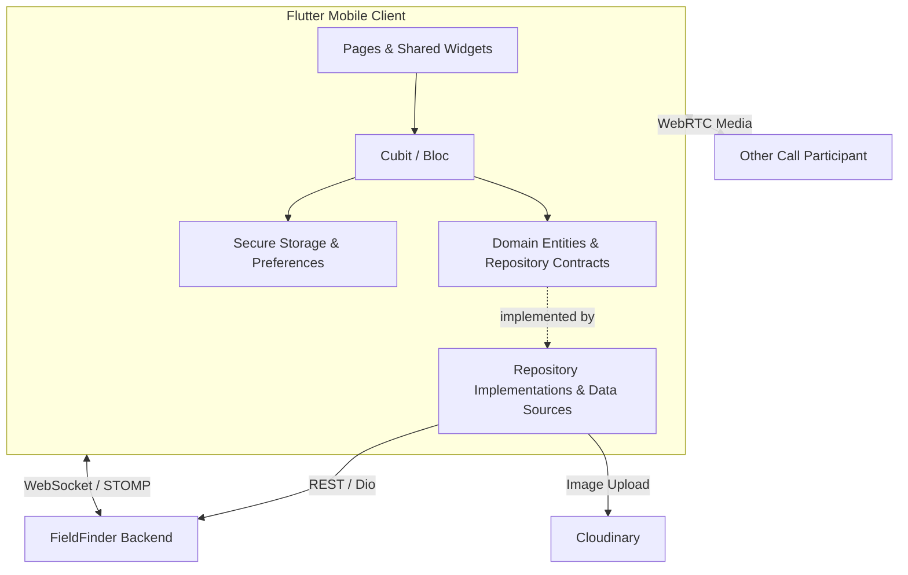

# FieldFinder Mobile

[](https://flutter.dev/)
[](pubspec.yaml)
[](android/app/build.gradle.kts)
[](lib/features)
[](lib/features/call)
[](lib/core/constants/api_constants.dart)

> A Flutter sports companion for pitch booking, equipment shopping, AI-assisted discovery, and real-time communication.

---

## Table of Contents

- [Overview](#overview)
- [Key Features](#key-features)
- [User Roles](#user-roles)
- [Architecture](#architecture)
- [Tech Stack](#tech-stack)
- [Getting Started](#getting-started)
- [Project Structure](#project-structure)
- [Backend Integration](#backend-integration)
- [Testing](#testing)
- [Build & Release](#build--release)
- [Troubleshooting](#troubleshooting)
- [Contributors](#contributors)

---

## Overview

FieldFinder is a sports ecosystem combining **football pitch booking** and **sports equipment e-commerce** with an AI-powered conversational interface. This repository contains the **Flutter client**, branded **SportsHub** in the application, connecting users, sports facility providers, delivery shippers, and administrators.

The mobile client integrates with the FieldFinder backend through REST APIs and WebSocket connections. AI processing, booking validation, payment processing, and recommendation services are handled by the backend; the app provides the discovery, checkout, communication, and management interfaces.

Built as a Bachelor's thesis project at **UIT — VNU-HCM**, the app brings facility discovery and equipment shopping into one experience.

## Key Features

| Area | Capabilities |
| --- | --- |
| **Pitch Discovery & Booking** | Browse and search pitches, explore locations on a map, select booking slots, pay, save favorites, and submit reviews. |
| **Sports Equipment Shopping** | Browse products, manage a cart, apply vouchers, check out, track orders, and review purchases. |
| **AI Assistant** | Chat-based assistance for sports facility and equipment discovery, with image-based interactions and voice input. |
| **Authentication** | Email registration and login, OTP verification, Google/Facebook sign-in, and passkey authentication. |
| **Chat & Calls** | User-to-user messaging, image/video sharing, message reactions, and WebRTC calling. |
| **Live Tracking** | Location-aware maps, route display, and delivery tracking. |
| **Wallet & Rewards** | Wallet flows, bank accounts, payment PIN, refund requests, vouchers, loyalty points, and membership tiers. |
| **Notifications** | In-app notifications with real-time updates over WebSocket. |
| **Management Tools** | Provider, shipper, and admin interfaces for operational workflows, reporting, and review moderation. |

Feature availability depends on backend configuration, account permissions, and device capabilities.

## User Roles

| Role | Main Workflows |
| --- | --- |
| **Customer** | Discover and book pitches, purchase equipment, manage bookings and orders, chat, and review services. |
| **Provider** | Manage sports facilities and provider information, handle bookings, and view provider-related reports. |
| **Shipper** | Handle deliveries, share tracking updates, and manage COD remittance and wallet workflows. |
| **Administrator** | Manage users, pitches, products, bookings, orders, revenue, account reviews, and review moderation. |

## Architecture

The codebase follows a **feature-oriented structure**, with most modules organized into presentation, domain, and data layers.



### Application flow

1. **Startup:** `main.dart` loads `env.config`, initializes Vietnamese date formatting, and wires repositories and state providers.
2. **Presentation:** pages and widgets render state and forward user actions to Cubit/Bloc controllers.
3. **Data access:** repositories and data sources communicate with the backend through the shared Dio client.
4. **Real-time features:** dedicated services handle messaging, notifications, call signaling, and tracking updates.
5. **Local persistence:** secure storage and shared preferences support authentication and local application data.

Module layouts vary; some features use a smaller structure where separate layers are unnecessary.

## Tech Stack

| Layer | Technologies |
| --- | --- |
| **Application** | Flutter, Dart, Material 3 |
| **State Management** | flutter_bloc, Equatable |
| **Networking** | Dio, flutter_dotenv |
| **Authentication** | google_sign_in, flutter_facebook_auth, passkeys |
| **Local Storage** | flutter_secure_storage, shared_preferences |
| **Real-Time Communication** | stomp_dart_client, flutter_webrtc |
| **Maps & Location** | flutter_map, latlong2, geolocator |
| **Voice & Permissions** | speech_to_text, permission_handler |
| **Media** | image_picker, cached_network_image, video_player, chewie |
| **Charts & Documents** | fl_chart, pdf, printing |
| **Sharing & Navigation** | share_plus, open_file, url_launcher |
| **Testing & Linting** | flutter_test, flutter_lints |

See [pubspec.yaml](pubspec.yaml) for dependency versions, bundled assets, and application versioning.

## Getting Started

### Prerequisites

- Flutter SDK with Dart satisfying **`^3.11.0`** (`>=3.11.0 <4.0.0`).
- Android Studio and Android SDK, with an emulator or a physical Android device.
- **Android 9 / API 28 or newer**, as configured in the Android module.
- A JDK compatible with the project's Gradle setup; Java/Kotlin compilation targets **Java 17**.
- A running FieldFinder backend accessible from the target device.
- For iOS development: macOS, Xcode, and the iOS tooling required by Flutter.

### Install Dependencies

From the parent `FS` workspace:

```bash
cd FSMobileApp
flutter doctor -v
flutter pub get
```

If you already opened the mobile project directory, run the Flutter commands there directly.

### Environment Variables

Create or update **`env.config`** beside `pubspec.yaml`:

```dotenv
# Backend REST API — include the /api suffix
BASE_URL=http://10.0.2.2:8080/api

# Google OAuth Web Client ID
WEB_CLIENT_ID=your-google-web-client-id.apps.googleusercontent.com

# Client-side Cloudinary upload configuration
NEXT_PUBLIC_CLOUDINARY_CLOUD_NAME=your-cloud-name
NEXT_PUBLIC_CLOUDINARY_UPLOAD_PRESET=your-upload-preset
```

| Variable | Purpose |
| --- | --- |
| `BASE_URL` | Backend REST API base URL, including `/api`. |
| `WEB_CLIENT_ID` | Google OAuth Web Client ID passed to Google Sign-In as `serverClientId`. |
| `NEXT_PUBLIC_CLOUDINARY_CLOUD_NAME` | Cloudinary cloud used for image uploads. |
| `NEXT_PUBLIC_CLOUDINARY_UPLOAD_PRESET` | Upload preset used by the direct image upload flow. |

The app explicitly loads `env.config`, which is registered as a Flutter asset. Restart the app after changing its values.

> **Client configuration:** bundled assets can be extracted from the app. Keep Cloudinary API secrets, backend credentials, and other server-side secrets outside `env.config`.

### Connect to the Backend

| Environment | Example `BASE_URL` |
| --- | --- |
| **Android Emulator** | `http://10.0.2.2:8080/api` |
| **Physical Device on LAN** | `http://192.168.1.100:8080/api` |
| **Deployed Backend** | `https://your-api-domain.example/api` |

Replace the host and port with your backend configuration. For a physical device, ensure the phone can reach the development machine over the network, the backend listens on a reachable interface, and the firewall allows the backend port. `localhost` on a phone refers to the phone itself.

Backend source is available in the parent workspace at `../FieldFinder_BE`.

### Run Locally

```bash
# List connected devices
flutter devices

# Run on the selected device
flutter run -d <device-id>
```

Replace `<device-id>` with an ID from `flutter devices`, or use `flutter run` when only one target is available.

### Social Login & Passkeys

Google and Facebook sign-in require matching provider and native application configuration:

- **Android application ID:** `vn.mttt.sportshub`.
- **Android Facebook resources:** `android/app/src/main/res/values/strings.xml`.
- **iOS URL schemes and Facebook settings:** `ios/Runner/Info.plist`.
- **Google Web Client ID:** `WEB_CLIENT_ID` in `env.config`.

Update provider settings when changing application identifiers or signing certificates. Passkeys also require compatible backend and application association settings.

## Project Structure

```text
FSMobileApp/
├── lib/
│   ├── main.dart                  # Configuration and application wiring
│   ├── app.dart
│   ├── core/
│   │   ├── constants/             # API paths, colors, and contact information
│   │   ├── network/               # Shared Dio client
│   │   ├── storage/               # Authentication token storage
│   │   ├── location/              # Location helpers and map picker
│   │   ├── tracking/              # Tracking connection and route handling
│   │   ├── voice/                 # Speech input service
│   │   └── utils/                 # Shared utilities
│   ├── features/
│   │   ├── auth/                  # Authentication, OTP, and passkeys
│   │   ├── home/                  # Home, search, and search history
│   │   ├── pitch/                 # Pitch details and booking
│   │   ├── product/               # Product browsing and details
│   │   ├── cart/                  # Shopping cart
│   │   ├── checkout/              # Checkout and payment screens
│   │   ├── chat/                  # Messaging and AI chat interfaces
│   │   ├── call/                  # Call signaling and WebRTC
│   │   ├── profile/               # User and provider profiles
│   │   ├── notification/          # Notifications and live updates
│   │   ├── shipper/               # Delivery and COD workflows
│   │   ├── admin/                 # Administration and reporting
│   │   └── ...                    # Wallet, rewards, reviews, refunds, etc.
│   └── shared/                    # Reusable widgets and navigation notifications
├── assets/                        # Images, fonts, and application icon
├── test/                          # Unit tests
├── android/                       # Native Android project
├── ios/                           # Native iOS project
├── web/                           # Web entry point and supporting assets
├── env.config                     # Client environment configuration
└── pubspec.yaml                   # Dependencies, assets, and app version
```

A typical feature module uses:

```text
feature/
├── data/                          # Data sources, models, repository implementations
├── domain/                        # Entities and repository contracts
└── presentation/                  # Cubit/Bloc, pages, and widgets
```

## Backend Integration

REST paths are centralized in [ApiConstants](lib/core/constants/api_constants.dart), while shared HTTP configuration lives in [DioClient](lib/core/network/dio_client.dart).

| Domain | Example API Paths |
| --- | --- |
| **Authentication** | `/auth/login`, `/auth/register`, `/auth/refresh-token` |
| **Passkeys** | `/auth/passkey/register/start`, `/auth/passkey/login/start` |
| **Pitches & Bookings** | `/pitches`, `/bookings`, `/bookings/slots` |
| **Products & Orders** | `/products`, `/cart`, `/orders` |
| **Favorites & Reviews** | `/favorites/pitches`, `/reviews`, `/item-reviews` |
| **AI Assistance** | `/ai/chat`, `/ai/image` |
| **Chat & Calls** | `/chat/history`, `/chat/conversations`, `/call/ice-config` |
| **Administration** | `/admin/users`, `/admin/bookings`, `/admin/statistics/overview` |

Paths above are relative to `BASE_URL`. Consult the backend implementation for request methods, payloads, authorization, and the full API contract.

**WebSocket endpoint:** the app derives `/ws` from the backend host. For example, `BASE_URL=http://host:8080/api` produces `http://host:8080/ws`. The STOMP client uses an HTTP SockJS URL and handles transport negotiation internally.

## Testing

Run from the mobile project directory:

```bash
# Static analysis
flutter analyze

# Unit tests
flutter test
```

Existing test files cover:

- Product model parsing.
- Chat message model behavior.
- Booking slot entities.
- Route polyline decoding and path handling.

Device and backend integration checks are still needed for authentication, payments, location permissions, live messaging, and calls. The commands above describe validation steps; they do not imply those checks have passed in your environment.

## Build & Release

### Android APK

```bash
flutter build apk --release
```

Output: `build/app/outputs/flutter-apk/app-release.apk`.

### Android App Bundle

```bash
flutter build appbundle --release
```

Output: `build/app/outputs/bundle/release/app-release.aab`.

> **Release signing:** the current [Android build configuration](android/app/build.gradle.kts) signs release builds with the debug key. Configure a production signing key before distributing an official release.

Application version and build number are defined in `pubspec.yaml`. Before release, use the intended backend URL and verify social login against the release signing certificate.

### iOS

Build iOS on macOS after configuring the Xcode signing team, bundle identifier, and native integrations:

```bash
flutter build ios --release
```

Complete device signing and distribution through Xcode or your iOS release workflow.

## Troubleshooting

| Symptom | What to Check |
| --- | --- |
| **Cannot load `env.config`** | Confirm the file exists beside `pubspec.yaml`, the name matches exactly, and dependencies have been installed. |
| **API timeout / connection refused** | Check the backend process, `BASE_URL`, host address, port, network access, and firewall. |
| **Chat or notifications do not update** | Verify `/ws` connectivity, backend WebSocket support, and the current authentication session. |
| **Google/Facebook login fails** | Check client IDs, package/bundle identifiers, URL schemes, and provider signing certificate configuration. |
| **Location or voice input unavailable** | Grant location/microphone permissions and enable the required device services. |
| **Image upload fails** | Check the Cloudinary cloud name, upload preset, and upload policy. |
| **Dependency resolution fails** | Confirm the Dart SDK bundled with Flutter satisfies the constraint in `pubspec.yaml`. |

## Contributors

| Student ID | Name | Role |
| --- | --- | --- |
| 22521529 | Vũ Hoàng Trọng Trí | Mobile (Flutter), UI/UX |
| 22521530 | Huỳnh Minh Triết | Backend, AI Integration, ML Pipeline, DevOps |

---

**Academic context:** Mobile client for the Bachelor's thesis project, “Building an AI-integrated mobile app for sports players with a smart assistant for finding facilities and equipment,” at UIT (University of Information Technology, VNU-HCM), 2026. Advisor: ThS. Trần Thị Hồng Yến.
